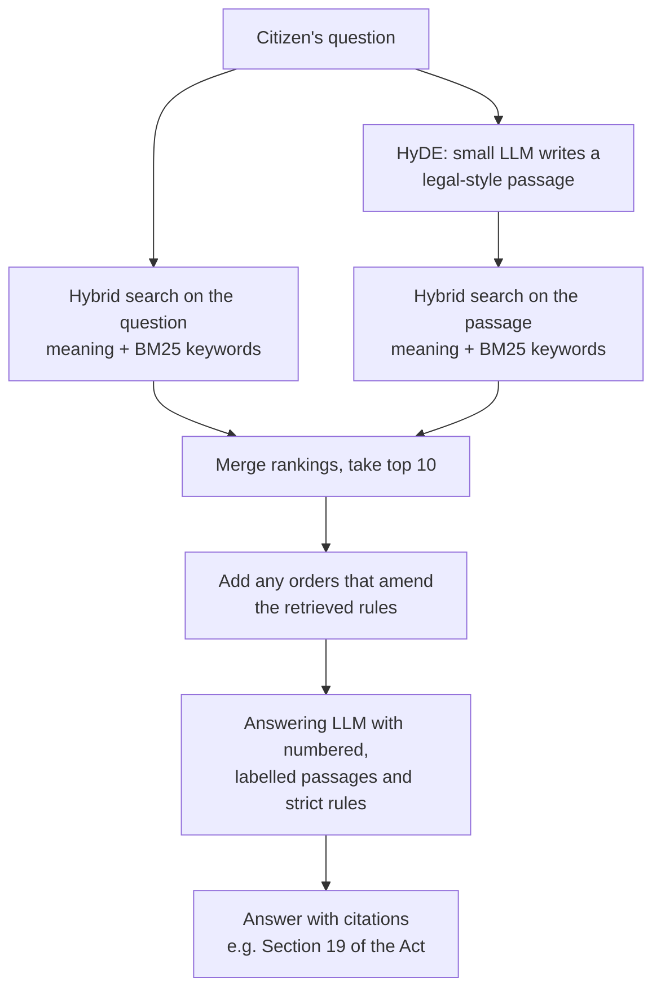

# AP RTI Assistant

A chatbot that answers ordinary people's questions about the **Right to Information
(RTI) Act, 2005, as it applies in Andhra Pradesh**, using only documents the AP
government itself publishes, and citing where each answer comes from.

This file explains the problem, what has been built, what was measured, what worked,
what didn't, and what is still weak. The detailed working log, with every decision and
number, is in [`context.md`](context.md).

> **Status (4 Oct 2026):** working demo with a web page, a terminal chat and
> follow-up questions. On casual, citizen-style questions, the text that answers the
> question now reaches the model **82%** of the time, up from about **50%** for the
> first version. Not yet reliable enough to run unsupervised.
>
> **Next major goal:** grow this single-domain RTI bot into a multi-domain assistant
> for the AP government (RTI, finance, agriculture, ...) that routes each question to
> the right domain(s) before searching. See [§7](#7-whats-next).

---

## 1. The problem

### 1.1 The information exists, but citizens can't use it

The RTI Act lets any citizen demand information from government. To use it you need to
know how to apply, what it costs, how long they have to reply, what they can refuse,
and how to appeal.

All of that is on the AP State Portal (`ap.gov.in` → **RTI & Acts**). But:

- **It's a filing cabinet, not a guide.** The section holds **546 documents** across 7
  sub-sections. Most are there because Section 4(1)(b)(v) of the Act obliges every
  authority to publish *"the rules, regulations, instructions, manuals and records held
  by it"*. So the menu is full of civil-service promotion rules and secretariat manuals.
  Only a few dozen documents are actually about using RTI.
- **The RTI Act itself isn't in the "Acts" section.** It's buried under
  *Department – Org RTI → GAD → "GOs / Governors Reports / Other Instructions under
  section 4(1)(A)"*, in a file titled just `RTI ACT`.
- **The one page written for citizens is empty.** "Instruction on RTI" lists *How to
  apply · Fee payable · Time limit · Appeal Provision*, but none of these items links to
  anything, and the "Download Pdf" button has no link either.
- **Part of the site is broken.** In the department section, opening a second
  department shows the previous one's contents. That hides 282 of its 285 files.

### 1.2 Why a standard chatbot fails here

The obvious fix is a RAG chatbot (Retrieval-Augmented Generation): find the relevant
passages, give them to an LLM, and have it answer. We built one, and it failed on
exactly the questions citizens ask most. The reason is a **vocabulary gap**:

| A citizen asks… | The law says… |
|---|---|
| "How do I **apply**?" | "shall **make a request in writing**" |
| "They didn't **reply**" | "shall be **deemed to have refused** the request" |
| "Can I **complain to the boss**?" | "appeal to the officer **senior in rank**" |
| "What's the **deadline**?" | "within **thirty days** of the receipt of the request" |

Half the words a citizen naturally uses (*reply, ask, deadline, ignore, boss*) never
appear in the Act at all. Search tools, whether they match meaning or keywords, have
little to connect the two.

**This is a known, published problem, not a quirk of this project.** A 2026 study of
government benefits search, *[The Vocabulary Gap Is an Equity Gap](https://arxiv.org/html/2609.01645)*,
measured the same effect. With formally worded questions, keyword search found the right
passage in its top 5 results **100%** of the time; with plain-language questions,
**44%**. Plain questions shared only **11%** of their content words with the right
passage, against 63% for formal ones. Legal retrieval benchmarks show the same pattern.
The people who most need help are the worst served.

### 1.3 Constraints

- **Cheap to run.** It's meant as a public service. Local embeddings, a free-tier LLM,
  no expensive infrastructure.
- **Grounded.** A confident wrong answer about a legal right is worse than "I don't
  know". Every answer must come from, and cite, the documents.
- **Understandable.** Built step by step, keeping the code minimal and explainable.

---

## 2. The data

We audited all 546 documents in the RTI & Acts section and classified every one.

| | documents |
|---|---|
| Published in the section | 546 |
| Actually about RTI | 194 |
| …of which quarterly filing statistics (useless for Q&A) | 124 |
| Substantive RTI documents | 69 |
| **Indexed, after removing duplicates, scans and Telugu editions** | **41** (398 pages) |

The 41 documents form three layers:

1. **The law.** The RTI Act 2005 (23 pages): how to apply, fees, deadlines, exemptions,
   appeals, penalties.
2. **AP's implementation.** 26 government orders (2005–2011): the AP fee rules, setting
   up the Information Commission, appointments, compliance instructions.
3. **Department disclosures.** 13 departmental "Section 4(1)(b)" manuals: what each
   department holds and who its Public Information Officer is.

Plus the text of the portal's "Instruction on RTI" page, the only source naming the
current Information Commissioners.

**Known data gaps:** government orders stop at 2011; 2 Telugu manuals excluded (the
embedding model is English-only); 2 scanned manuals with no text version dropped; 1
file's link returns a 404 error.

---

## 3. What we did

### Phase 1: a plain ("vanilla") RAG baseline

The textbook pipeline, deliberately with nothing extra:

1. Split every document into 1,000-character chunks with 200-character overlap (766 chunks)
2. Turn each chunk into a vector with `all-MiniLM-L6-v2` (local embedding model)
3. Store them in Chroma (local vector database)
4. For a question: embed it, take the 8 most similar chunks
5. Send question + chunks to an LLM on Groq, return the answer

It ran end to end and handled some questions well. It failed on the important ones.

### Phase 2: diagnosing why it failed

**The benchmark failure.** Asked *"If I don't get a reply to my RTI application within
30 days, what can I do?"*, it answered **"I can't tell you"**, while the passage with the
exact answer (Section 19, the appeal provision) sat at **rank 31 of 766**. The model
behaved correctly; retrieval never delivered the evidence.

**Scoring confirmed it.** RAGAS, an LLM-judged RAG evaluation, rated
*faithfulness* **0.95** but *context precision* only **0.38**, and 0.14 on "how do I
apply". The model was trustworthy; retrieval was feeding it noise.

**What we ruled out.** Swapping the embedding model barely mattered: MiniLM 60% vs
bge-small 67% on 15 checks, a one-check difference. Both failed the same questions.

**What we found.** One rule explained almost every result:

> Retrieval succeeds when the question's **rare** word also appears in the answer, and
> fails when it doesn't.

*"How do I **apply** for information under the RTI Act?"* shares 60% of its words with the
correct passage, but they're `information`, `act` and `under`, which appear in 25–46% of
all chunks and carry no signal. Its one distinctive word, **apply** (in 1% of chunks),
isn't in the answer, because the law says *"make a request"*. Result: rank **106**.
Questions whose rare word *does* appear (`penalty`, `refuse`) ranked 2nd and 3rd.

Rewriting that question in the Act's own vocabulary, without copying any phrase from
the answer, moved it from **rank 106 to rank 6**. The search machinery was fine; the
question's wording was the problem.

**Two reference points.**
- **AP government's own chatbot** answered the 30-day question correctly, drawing on
  seven provisions across three sections of the Act. (Flaws: it described the central
  officer rather than the state one, and omitted the second appeal.)
- **An earlier project of ours** (`sar-rag_v1`) had already avoided the trap. It never
  searched with raw user input; it converted input into regulation-worded search phrases
  first.

### Phase 3: iterating to a working demo, measured at every step

**Method.** Before changing anything, we wrote question sets, verified each expected
answer exists in the documents, and **froze** them so changes couldn't be tuned toward
them. Each question has a *probe*, a short verbatim phrase from the text that answers it.
The test is simple and needs no LLM judge: **does the probe appear in the retrieved
chunks?**

| set | questions | wording | purpose |
|---|---|---|---|
| `dev` | 20 | fairly formal | used while iterating |
| `heldout` | 12 | casual | checked after architecture changes |
| `heldout2` | 12 | casual | written before query rewriting was built |
| `heldout3` | 10 | casual | written before the last two decisions |

**What each change did** (share of questions whose answer text was retrieved):

| change | dev | casual sets |
|---|---|---|
| Original pipeline | 65% | 50%, 50% |
| Chunks sized by **tokens**, sentence-aligned (no more truncation) | 70% | |
| + RTI Act **split by section** | 70% | |
| + document/section **title added before embedding** | 70%, ranking worse | |
| + **hybrid search** (meaning + BM25 keyword search) | 80% | |
| bge-small embeddings, 350-token chunks, hybrid | 85% | |
| same, **title prefix removed** | **95%** | 42%, 58% |
| + LLM **rewrites the question** (first attempt) | 85% | **25%** ↓ |
| + rewrite, fixed prompt | 90% | 58% |
| + **HyDE**, fused with the original question | **95%** | **75%, 92%, 60%** |
| + section titles on Act chunks (3 variants) | 95% | no gain |
| **+ retrieve 10 chunks instead of 8 (final)** | **95%** | **75%, 92%, 80%** |

**What we learned from it:**

- **Improving the plain pipeline alone did not help casual questions.** Better chunks,
  a better model and hybrid search took formal questions from 65% to 95%, but casual
  questions stayed around 50%. The vocabulary gap had to be bridged on the question side.
- **HyDE is what worked.** A small LLM writes a short, made-up passage in legal drafting
  style that *would* answer the question, and we search with that as well as the
  question. The made-up passage uses the law's vocabulary. It is used only for
  searching; users and the answering model never see it.
- **Naive query rewriting made things worse** (42% → 25%). The LLM padded every rewrite
  with "under the Right to Information Act, 2005… Andhra Pradesh", words present in
  every chunk that drown the real concept. Telling it to leave them out fixed it. This
  is the same rare-word mechanism found in Phase 2.
- **Adding titles to chunks before embedding hurt on this corpus**, in every form tried.
  Every government order's title contains "Right to Information Act", so the titles
  made chunks look alike. (Anthropic's *Contextual Retrieval* reports the opposite on
  other data.)
- **Hybrid search helped** whenever the question had a rare word that also appears in
  the answer (`penalty`, `court fee stamp`).
- **The AP fee schedule was in the documents all along.** Earlier we believed it wasn't,
  but that was retrieval failing. AP charges ₹10 per application, ₹5 at mandal level,
  nothing at village level, ₹2 per page, with white-card (BPL) holders exempt.

### Phase 4: fixing the answers, not just the retrieval

Retrieval scores don't show everything. Reading real answers in demo rehearsals exposed
failures a live demo would have shown:

| found | fix |
|---|---|
| Named a 2010 appointee as the **current** Information Commissioner | Portal page labelled as the most current source; answers must say when and by which order someone was appointed, and never call them current from a dated order |
| Gave the Water Resources Department's appeal officer and phone number for **any** office | Department manuals labelled by department; contacts only for that department |
| Quoted an inspection fee that a **later order had changed** | Amendments detected automatically; amending orders are added whenever the rule they change is retrieved |
| Said copyright was effectively the **only** ground for refusal; said the penalty was "₹25,000 **per day**" (it's ₹250/day, capped at ₹25,000) | Rules: partial answers must say what's missing; no "only" or "not permitted" unless a passage says so; copy figures exactly |
| **Crashed** when Groq's free-tier rate limit was hit | Automatic retry, then fall back to a smaller model with a visible note |

After these fixes, the same questions were answered correctly. Where evidence was
missing, answers said so, for example *"the Act contains other grounds in Section 8,
but those are not reproduced in the passages you have."*

---

## 4. How it works now



**Built once (ingest):**
- Text extracted from the 41 documents; the RTI Act split into its 31 sections
  (section titles checked against the Act's own text)
- Sentence-aligned chunks of 350 tokens with 60 overlap, sized for the embedding
  model's window: **535 chunks**, none truncated
- Each chunk labelled for citation: *"RTI Act 2005, Section 19: Appeal"*; department
  manuals with their department; the portal page as the most current source
- Amendment links found automatically between government orders
- Embedded with **`BAAI/bge-small-en-v1.5`** into Chroma

**Per question:**
- HyDE passage from Groq **`gpt-oss-20b`** (~1 s)
- Hybrid search for both question and passage, merged with Reciprocal Rank Fusion
  (a standard way to combine rankings); top 10, plus up to 4 amendment chunks (~1.5 s total)
- Answer from Groq **`gpt-oss-120b`**, falling back to `gpt-oss-20b` if rate-limited
  (~2–7 s)

### Is this still "vanilla" RAG?

**No.** Most changes are the plain pipeline done better; three go beyond it.

| still plain RAG (just better) | beyond plain RAG |
|---|---|
| token-based chunking | **hybrid search** (a second, keyword search) |
| splitting the Act by section | **HyDE** (one extra LLM call per question) |
| better embedding model | **amendment links** (pulls in related documents) |
| top-10 instead of top-8 | |
| source labels, stricter prompt | |

Still **not** used: rerankers, agents, multi-step reasoning.

**Conversation memory** (added 19 Sep): follow-ups like "what if i still dont get it"
are rewritten into a standalone question by `gpt-oss-120b` (falling back to `gpt-oss-20b` if
rate-limited) using the last 3 turns, and
that is what gets searched. The answer model also sees a short summary of those turns,
only to understand the question; facts must still come from the passages. It costs one
extra small LLM call, and only on follow-ups. Tested alternatives: adding the previous
question to the search text helped one follow-up slightly but hurt topic switches, so
the rewrite alone is used. **The rewrite is not reliable at carrying the topic** — see
the limitation below.

The table in Phase 3 shows why: **the plain improvements alone did not fix casual
questions; HyDE did.**

---

## 5. Results

### Retrieval: does the answering text reach the model?

| | formal questions (20) | casual questions (34) | all (54) |
|---|---|---|---|
| Original pipeline | 65% | ~50%* | — |
| **Current** | **95%** | **82%** | **87%** |

\*Measured on the first two casual sets (24 questions); the third set didn't exist yet.

### The questions that used to fail

| question | before | now |
|---|---|---|
| "How do I file an RTI application?" | correct passage at rank **445** | retrieved; answer cites Section 6 |
| "No reply in 30 days, what can I do?" | "**I can't tell you**" | first appeal within 30 days (s.19) and complaint to the Commission (s.18). Complete in some phrasings; in others it muddles first- and second-appeal details (see limitations) |
| "How much does an RTI cost in AP?" | "not in the documents" | ₹5 / ₹10 per application, ₹2 per page, BPL exemption, amended inspection fee |
| "Can the officer just say no?" | (mid-way version) called copyright effectively the only ground; penalty "₹25,000 per day" | correct penalty (₹250/day, capped at ₹25,000); says honestly that Section 8's grounds weren't retrieved |

Each question takes about 1.5 s to search and 2–7 s to answer, when Groq isn't
rate-limiting.

---

## 6. Known limitations

Stated plainly, because a demo audience should hear them.

- **About 1 in 5 casual questions still misses its answer**, and some misses are far
  off: for "can they refuse my RTI?", the exemptions section isn't in the top 40.
- **Lots of irrelevant text still comes back.** The test measures whether the right
  chunk arrives, not how much noise comes with it. In one demo question only 1–3 of the
  8 chunks retrieved were relevant. Not yet measured systematically.
- **Answers can still misattribute when evidence is missing.** Example: a correct
  conclusion about private companies, citing the wrong section (4(1)(b) instead of 2(h)).
- **Appeal answers can mix up the two appeal stages.** In a 19 Sep test ("not replied
  for 45 days"), the answer correctly led with the first appeal within 30 days, but
  attributed the first appeal's late-filing rule and 30/45-day decision limit to the
  Information Commission, and omitted the second appeal's 90-day limit. It also
  offered one department's appeal officer as an example and an old Hyderabad address.
  The same answer was complete when asked as "the officer keeps delaying my rti".
- **It can't reliably name current officials.** Government orders stop at 2011; the
  current Commissioner appears only on the portal page, which isn't always retrieved.
  The answer now says so rather than guessing.
- **Free-tier throughput:** roughly one answer per 30 seconds before Groq throttles.
- **~30-second startup**, caused by the Python environment (hundreds of globally
  installed packages slow down loading the embedding library), not the pipeline. A
  project-specific virtual environment would fix it.
- **Each question costs one extra small LLM call** (HyDE), in tension with the goal of
  zero per-question overhead.
- **No untouched test set remains.** Every question set has now informed some decision,
  so any further tuning needs a new one written first.
- English only.
- **The follow-up rewrite does not reliably carry the topic.** Asked "what if my family
  belongs to bpl" straight after a fee question, the rewrite came back as "What if my
  family belongs to BPL?" with no mention of fees, and AP's white-card exemption ranked
  43rd, so the answer gave only the Act's general BPL proviso and missed the AP rule.
  Switching the rewrite to the larger model fixed it in an isolated test (rank 1) but
  **not in the real conversation**, where it dropped the topic again. Cleaning markdown
  tables out of the earlier answer did not fix it either. Whether the topic survives
  depends on how the previous answer happens to be worded. Workaround: name the subject
  in the follow-up ("do BPL families have to pay the RTI fee?").

---

## 7. What's next

### Next major goal: a multi-domain AP government assistant

The RTI bot is the first domain. The plan is to extend it to other departments
(finance, agriculture, ...) without losing what was learned here:

1. **Route first.** Classify each question into one or more domains (RTI, finance,
   agriculture, or a mix) before searching, so each search runs over the right corpus.
2. **Search per domain** with the pipeline built here (HyDE + hybrid search +
   amendment links), each domain with its own index.
3. **Draft with a domain agent** that writes the cited answer, and merges results when
   a question spans domains.
4. **Continue the conversation cheaply.** Follow-ups that stay on the same topic reuse
   the routing and retrieved documents instead of re-running every step.

The detailed design is still to be decided; see [`PROJECT_BRIEF.md`](PROJECT_BRIEF.md).

### Improving the RTI domain

1. **Project virtual environment:** faster startup, cleaner dependencies.
2. **Write a fresh test set** before any further change.
3. **Measure the noise** (how many retrieved chunks are irrelevant), then test a
   **reranker**, a second, more careful pass that keeps only the best chunks.
4. **The cost-efficiency experiment.** Replace per-question HyDE with work done once at
   ingest time: generate the questions each chunk answers and store them with it
   (the idea behind Doc2Query). If it matches HyDE, the extra per-question LLM call
   disappears.
5. **Evaluate answers, not just retrieval.** The worst demo failures were in the
   answers themselves.

### The research direction

Most production RAG systems close quality gaps by spending more **per question**: bigger
models, rerankers, multi-agent pipelines. For a public service, the cheaper route is to
do the work **once, at ingest time**: better structure, links between documents, and
vocabulary bridges stored with the data. Preprocessing for retrieval is well studied
(Doc2Query, Contextual Retrieval), so novelty would not come from the technique itself.
It could come from:

- the domain: Indian statutory and government-order text, with OCR damage and mixed
  languages
- the gap between a citizen's question and a statutory provision, where the answer is
  often spread across sections that never mention each other
- a hard cost ceiling: how far index-time work alone can go

Part of that is already visible here. The two biggest content fixes, section-aware
chunking and amendment links, cost nothing per question.

---

## 8. Running it

```bash
pip install -r requirements.txt
```

Create a `.env` file in the project root with your key from
[console.groq.com](https://console.groq.com):
```
GROQ_API_KEY=gsk_...
```

The documents are already in `ingest/documents/`. Build the index once:
```bash
python ingest/load_and_chunk.py
```
```bash
python ingest/build_index.py
```

Start the web page (wait ~30 s to load; it opens http://127.0.0.1:8000 in your browser):
```bash
python rag/web.py
```

Type a question or click a suggested one. Citations like [2] are clickable and open
that source's text; "How it searched" shows the HyDE passage. Ask about one question
every 30 s. Stop it with Ctrl+C. It uses only Python's standard library, so no extra
installs are needed. If port 8000 is busy, run `python rag/web.py --port 8080`.

Or use the terminal chat instead:
```bash
python rag/chat.py
```

In the chat, `/sources` shows the retrieved passages and the HyDE search passage.

Measure retrieval:
```bash
python eval/retrieval_eval.py
```
Add `--no-hyde` to see the difference HyDE makes. `eval/run_ragas.py` runs the LLM-judged
RAGAS evaluation; it needs extra packages (`ragas`, `langchain-groq`,
`langchain-community<0.4`).

### Project layout

```
ap-rti-assistant/
├── README.md                 ← this file
├── context.md                ← detailed working log, every decision and number
├── PROJECT_BRIEF.md          ← one-page summary and next goal
├── requirements.txt
├── docs/
│   ├── AP RTI Assistant Knowledge Base.html   self-contained explainer page
│   └── DATA_COLLECTION_BRIEF.md   what data is missing, as a task brief for an agent
├── ingest/
│   ├── documents/            the 41 source documents
│   ├── corpus_manifest.json  title, department, source URL, checksum per document
│   ├── inventory_rti_acts.json   audit of all 546 documents on the site
│   ├── load_and_chunk.py     documents → section-aware chunks → chunks.json
│   └── build_index.py        chunks → embeddings → Chroma
├── rag/
│   ├── retrieve.py           HyDE + hybrid search + amendment links
│   ├── answer.py             passages + question → cited answer
│   ├── chat.py               terminal chat
│   ├── web.py                local web page server (standard library only)
│   └── web.html              the web page
├── eval/
│   ├── demo_questions.json   frozen question sets with probes
│   ├── retrieval_eval.py     retrieval test (no LLM judge)
│   ├── run_ragas.py, testset.json   LLM-judged evaluation
│   └── compare_embeddings.py older embedding comparison
└── data/chroma/              vector database (generated)
```

---

## References

- *The Vocabulary Gap Is an Equity Gap: Register Mismatch in Retrieval Systems for
  Public-Benefits Access* (2026). [arXiv 2609.01645](https://arxiv.org/html/2609.01645)
- *Benchmarking Legal RAG: The Promise and Limits of AI Statutory Surveys* (2026).
  [arXiv 2603.03300](https://arxiv.org/html/2603.03300)
- Nogueira et al., *Document Expansion by Query Prediction* (Doc2Query, 2019).
  [arXiv 1904.08375](https://arxiv.org/pdf/1904.08375)
- Anthropic, *Contextual Retrieval* (2024).
  [anthropic.com](https://www.anthropic.com/engineering/contextual-retrieval)
- Gao et al., *Precise Zero-Shot Dense Retrieval without Relevance Labels* (HyDE, 2022).
  [overview](https://www.emergentmind.com/topics/hypothetical-document-embeddings-hyde)
- Jeong et al., *Adaptive-RAG* (2024).
  [arXiv 2403.14403](https://www.alphaxiv.org/overview/2403.14403)
- The Right to Information Act, 2005 (Act No. 22 of 2005), and AP G.O.Ms.No. 454, 530,
  545 and 740 (AP RTI fee rules and amendments), all included in `ingest/documents/`.
