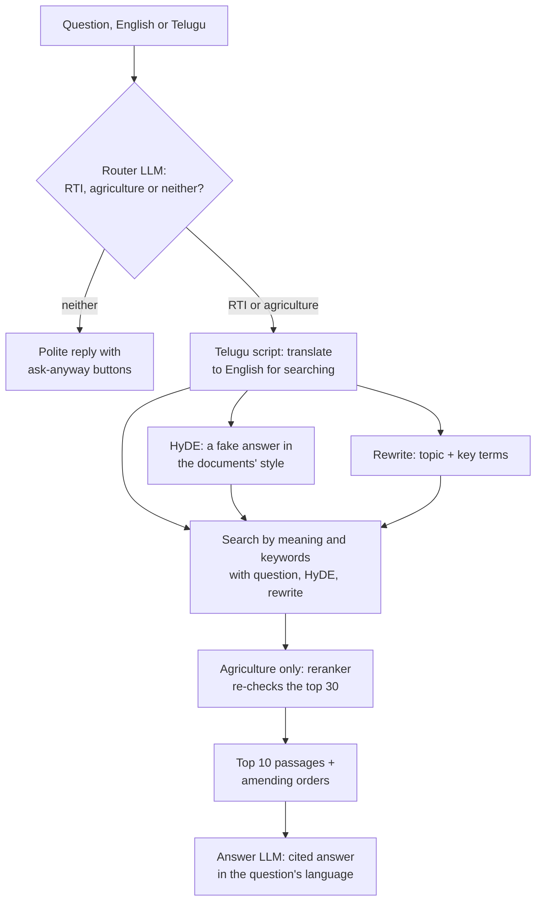

# AP Government Assistant

**Ask the Andhra Pradesh government a question in your own words, in English or Telugu,
and get the answer its own documents give, with the document named.**

It answers only from official documents and cites every source. When the documents don't
cover something, it says so instead of guessing. It understands Telugu typed in Telugu
script or in English letters ("rti fee entha"), and it follows a conversation, not just
single questions.

**The bigger idea** (every department, every state, general politics, and the people who
most need government help) is in [VISION.md](VISION.md). This README covers what is
built today: the Andhra Pradesh assistant.

## What works today, and what is planned

| Area | State |
|---|---|
| Right to Information: applying, fees, time limits, appeals, penalties | **Live**: 41 official documents |
| Agriculture: farm schemes, subsidies, crop insurance, farm rules | **Live**: 44 official documents |
| Answers in English, Telugu script, or Telugu in English letters | **Live** |
| Finance: pensions, stamp duty and registration, vehicle tax, the state budget | Planned next |
| Schemes and opportunities by social category (SC, ST, BC, EWS) | Planned |
| Government jobs and recruitment | Planned |
| Land: buying, title checks, registration | Planned |

Everything below describes how the live part was built and measured.

---

It started as an RTI-only bot: sections 1–3 tell that story, section 4 onwards describes
the current two-domain system. The detailed working log, with every decision and number,
is in [`context.md`](context.md); every retrieval experiment is in
[`docs/RETRIEVAL_EXPERIMENTS.md`](docs/RETRIEVAL_EXPERIMENTS.md).

> **Status (5 Oct 2026):** one web page answers both RTI and agriculture questions. A
> small LLM step first decides which documents a question belongs to (**31 of 32**
> correct on fresh questions); questions about neither are politely declined. The text
> that answers the question reaches the answer model for **96%** of RTI test questions
> (79/82) and **86%** of agriculture ones (80/93). Telugu questions are translated for the
> search and answered in Telugu. Runs locally, or with one Docker command
> ([§8](#8-running-it)). Not yet reliable enough to run unsupervised.
>
> **Next:** finance as a third domain, with subcategories. See [§7](#7-whats-next).

---

## 1. The problem

### 1.1 The information exists, but citizens can't use it

The RTI Act lets any citizen demand information from government. To use it you need to
know how to apply, what it costs, how long they have to reply, what they can refuse,
and how to appeal.

All of that is on the AP State Portal (`ap.gov.in` → **RTI & Acts**). But:

- **It's a filing cabinet, not a guide.** The section holds **546 documents** across 7
  sub-sections. Most are there because Section 4(1)(b)(v) of the Act obliges every
  authority to publish *"the rules, regulations, instructions, manuals and records held
  by it"*. So the menu is full of civil-service promotion rules and secretariat manuals.
  Only a few dozen documents are actually about using RTI.
- **The RTI Act itself isn't in the "Acts" section.** It's buried under
  *Department – Org RTI → GAD → "GOs / Governors Reports / Other Instructions under
  section 4(1)(A)"*, in a file titled just `RTI ACT`.
- **The one page written for citizens is empty.** "Instruction on RTI" lists *How to
  apply · Fee payable · Time limit · Appeal Provision*, but none of these items links to
  anything, and the "Download Pdf" button has no link either.
- **Part of the site is broken.** In the department section, opening a second
  department shows the previous one's contents. That hides 282 of its 285 files.

### 1.2 Why a standard chatbot fails here

The obvious fix is a RAG chatbot (Retrieval-Augmented Generation): find the relevant
passages, give them to an LLM, and have it answer. We built one, and it failed on
exactly the questions citizens ask most. The reason is a **vocabulary gap**:

| A citizen asks… | The law says… |
|---|---|
| "How do I **apply**?" | "shall **make a request in writing**" |
| "They didn't **reply**" | "shall be **deemed to have refused** the request" |
| "Can I **complain to the boss**?" | "appeal to the officer **senior in rank**" |
| "What's the **deadline**?" | "within **thirty days** of the receipt of the request" |

Half the words a citizen naturally uses (*reply, ask, deadline, ignore, boss*) never
appear in the Act at all. Search tools, whether they match meaning or keywords, have
little to connect the two.

**This is a known, published problem, not a quirk of this project.** A 2026 study of
government benefits search, *[The Vocabulary Gap Is an Equity Gap](https://arxiv.org/html/2609.01645)*,
measured the same effect. With formally worded questions, keyword search found the right
passage in its top 5 results **100%** of the time; with plain-language questions,
**44%**. Plain questions shared only **11%** of their content words with the right
passage, against 63% for formal ones. Legal retrieval benchmarks show the same pattern.
The people who most need help are the worst served.

### 1.3 Constraints

- **Cheap to run.** It's meant as a public service. Local embeddings, a free-tier LLM,
  no expensive infrastructure.
- **Grounded.** A confident wrong answer about a legal right is worse than "I don't
  know". Every answer must come from, and cite, the documents.
- **Understandable.** Built step by step, keeping the code minimal and explainable.

---

## 2. The data

We audited all 546 documents in the RTI & Acts section and classified every one.

| | documents |
|---|---|
| Published in the section | 546 |
| Actually about RTI | 194 |
| …of which quarterly filing statistics (useless for Q&A) | 124 |
| Substantive RTI documents | 69 |
| **Indexed, after removing duplicates, scans and Telugu editions** | **41** (398 pages) |

The 41 documents form three layers:

1. **The law.** The RTI Act 2005 (23 pages): how to apply, fees, deadlines, exemptions,
   appeals, penalties.
2. **AP's implementation.** 26 government orders (2005–2011): the AP fee rules, setting
   up the Information Commission, appointments, compliance instructions.
3. **Department disclosures.** 13 departmental "Section 4(1)(b)" manuals: what each
   department holds and who its Public Information Officer is.

Plus the text of the portal's "Instruction on RTI" page, the only source naming the
current Information Commissioners.

**Known data gaps:** government orders stop at 2011; 2 Telugu manuals excluded (the
embedding model is English-only); 2 scanned manuals with no text version dropped; 1
file's link returns a 404 error.

**Agriculture (added Oct 2026):** 44 official documents — AP government orders (crop
insurance, Annadata Sukhibhava, subsidies, MSP procurement, disaster relief), scheme
guidelines, and central Acts on seeds, fertilisers and pesticides. How they were chosen:
`ingest/incoming/agriculture/REPORT.md`.

---

## 3. What we did

### Phase 1: a plain ("vanilla") RAG baseline

The textbook pipeline, deliberately with nothing extra:

1. Split every document into 1,000-character chunks with 200-character overlap (766 chunks)
2. Turn each chunk into a vector with `all-MiniLM-L6-v2` (local embedding model)
3. Store them in Chroma (local vector database)
4. For a question: embed it, take the 8 most similar chunks
5. Send question + chunks to an LLM on Groq, return the answer

It ran end to end and handled some questions well. It failed on the important ones.

### Phase 2: diagnosing why it failed

**The benchmark failure.** Asked *"If I don't get a reply to my RTI application within
30 days, what can I do?"*, it answered **"I can't tell you"**, while the passage with the
exact answer (Section 19, the appeal provision) sat at **rank 31 of 766**. The model
behaved correctly; retrieval never delivered the evidence.

**Scoring confirmed it.** RAGAS, an LLM-judged RAG evaluation, rated
*faithfulness* **0.95** but *context precision* only **0.38**, and 0.14 on "how do I
apply". The model was trustworthy; retrieval was feeding it noise.

**What we ruled out.** Swapping the embedding model barely mattered: MiniLM 60% vs
bge-small 67% on 15 checks, a one-check difference. Both failed the same questions.

**What we found.** One rule explained almost every result:

> Retrieval succeeds when the question's **rare** word also appears in the answer, and
> fails when it doesn't.

*"How do I **apply** for information under the RTI Act?"* shares 60% of its words with the
correct passage, but they're `information`, `act` and `under`, which appear in 25–46% of
all chunks and carry no signal. Its one distinctive word, **apply** (in 1% of chunks),
isn't in the answer, because the law says *"make a request"*. Result: rank **106**.
Questions whose rare word *does* appear (`penalty`, `refuse`) ranked 2nd and 3rd.

Rewriting that question in the Act's own vocabulary, without copying any phrase from
the answer, moved it from **rank 106 to rank 6**. The search machinery was fine; the
question's wording was the problem.

**Two reference points.**
- **AP government's own chatbot** answered the 30-day question correctly, drawing on
  seven provisions across three sections of the Act. (Flaws: it described the central
  officer rather than the state one, and omitted the second appeal.)
- **An earlier project of ours** (`sar-rag_v1`) had already avoided the trap. It never
  searched with raw user input; it converted input into regulation-worded search phrases
  first.

### Phase 3: iterating to a working demo, measured at every step

**Method.** Before changing anything, we wrote question sets, verified each expected
answer exists in the documents, and **froze** them so changes couldn't be tuned toward
them. Each question has a *probe*, a short verbatim phrase from the text that answers it.
The test is simple and needs no LLM judge: **does the probe appear in the retrieved
chunks?**

| set | questions | wording | purpose |
|---|---|---|---|
| `dev` | 20 | fairly formal | used while iterating |
| `heldout` | 12 | casual | checked after architecture changes |
| `heldout2` | 12 | casual | written before query rewriting was built |
| `heldout3` | 10 | casual | written before the last two decisions |

**What each change did** (share of questions whose answer text was retrieved):

| change | dev | casual sets |
|---|---|---|
| Original pipeline | 65% | 50%, 50% |
| Chunks sized by **tokens**, sentence-aligned (no more truncation) | 70% | |
| + RTI Act **split by section** | 70% | |
| + document/section **title added before embedding** | 70%, ranking worse | |
| + **hybrid search** (meaning + BM25 keyword search) | 80% | |
| bge-small embeddings, 350-token chunks, hybrid | 85% | |
| same, **title prefix removed** | **95%** | 42%, 58% |
| + LLM **rewrites the question** (first attempt) | 85% | **25%** ↓ |
| + rewrite, fixed prompt | 90% | 58% |
| + **HyDE**, fused with the original question | **95%** | **75%, 92%, 60%** |
| + section titles on Act chunks (3 variants) | 95% | no gain |
| **+ retrieve 10 chunks instead of 8 (final)** | **95%** | **75%, 92%, 80%** |

**What we learned from it:**

- **Improving the plain pipeline alone did not help casual questions.** Better chunks,
  a better model and hybrid search took formal questions from 65% to 95%, but casual
  questions stayed around 50%. The vocabulary gap had to be bridged on the question side.
- **HyDE is what worked.** A small LLM writes a short, made-up passage in legal drafting
  style that *would* answer the question, and we search with that as well as the
  question. The made-up passage uses the law's vocabulary. It is used only for
  searching; users and the answering model never see it.
- **Naive query rewriting made things worse** (42% → 25%). The LLM padded every rewrite
  with "under the Right to Information Act, 2005… Andhra Pradesh", words present in
  every chunk that drown the real concept. Telling it to leave them out fixed it. This
  is the same rare-word mechanism found in Phase 2.
- **Adding titles to chunks before embedding hurt on this corpus**, in every form tried.
  Every government order's title contains "Right to Information Act", so the titles
  made chunks look alike. (Anthropic's *Contextual Retrieval* reports the opposite on
  other data.)
- **Hybrid search helped** whenever the question had a rare word that also appears in
  the answer (`penalty`, `court fee stamp`).
- **The AP fee schedule was in the documents all along.** Earlier we believed it wasn't,
  but that was retrieval failing. AP charges ₹10 per application, ₹5 at mandal level,
  nothing at village level, ₹2 per page, with white-card (BPL) holders exempt.

### Phase 4: fixing the answers, not just the retrieval

Retrieval scores don't show everything. Reading real answers in demo rehearsals exposed
failures a live demo would have shown:

| found | fix |
|---|---|
| Named a 2010 appointee as the **current** Information Commissioner | Portal page labelled as the most current source; answers must say when and by which order someone was appointed, and never call them current from a dated order |
| Gave the Water Resources Department's appeal officer and phone number for **any** office | Department manuals labelled by department; contacts only for that department |
| Quoted an inspection fee that a **later order had changed** | Amendments detected automatically; amending orders are added whenever the rule they change is retrieved |
| Said copyright was effectively the **only** ground for refusal; said the penalty was "₹25,000 **per day**" (it's ₹250/day, capped at ₹25,000) | Rules: partial answers must say what's missing; no "only" or "not permitted" unless a passage says so; copy figures exactly |
| **Crashed** when Groq's free-tier rate limit was hit | Automatic retry, then fall back to a smaller model with a visible note |

After these fixes, the same questions were answered correctly. Where evidence was
missing, answers said so, for example *"the Act contains other grounds in Section 8,
but those are not reproduced in the passages you have."*

### Phase 5: a second domain — agriculture (4 Oct)

44 official documents (AP government orders, scheme guidelines, central Acts) were
collected (`ingest/incoming/agriculture/REPORT.md`) and run through the same pipeline
with their own index and prompts (`rag/domains.py`). What agriculture needed that RTI
didn't: the document title embedded with each chunk (titles name the scheme and crop;
+13 points), at most one passage from a replaced scheme (YSR Rythu Bharosa was crowding
out its replacement), a glossary of local abbreviations (RBK, CCRC, KCC…), and answer
rules that know today's date and the 2024 scheme renames.

### Phase 6: testing ~40 search techniques per domain (4–5 Oct)

Fresh test sets were written first, including a final set used only once. Every LLM
output was cached so techniques were compared on identical text. The main finding: **the
two domains need opposite fixes.** RTI improves when an LLM names the legal topic of the
question (the model knows the RTI Act's wording); rerankers hurt it. Agriculture improves
most with a reranker that reads the question and each passage together (farmers name
concrete things — cashew, drone, cow — buried in long tables). Full results:
[`docs/RETRIEVAL_EXPERIMENTS.md`](docs/RETRIEVAL_EXPERIMENTS.md).

### Phase 7: one interface, Telugu, Docker (5 Oct)

A router sends each question to the right domain; Telugu-script questions are
translated to English for searching and answered in Telugu; the whole app runs in one
Docker container.

---

## 4. How it works now



**Built once, per domain (ingest):**
- Text extracted from the documents — **41 for RTI, 44 for agriculture**; the RTI Act
  split into its 31 sections; huge agriculture PDFs cut to their useful pages
- Sentence-aligned chunks of 350 tokens with 60 overlap: **535 RTI and 1,895 agriculture
  chunks**, none truncated
- Every chunk labelled for citation (*"RTI Act 2005, Section 19: Appeal"*,
  *"G.O.Ms.No.33 (2025)"*); amendment links between orders; replaced schemes marked
  "not in force"
- Embedded with **`BAAI/bge-small-en-v1.5`** (agriculture: title + chunk) into Chroma,
  one collection per domain; keyword (BM25) index built in memory at startup

**Per question** — which model does what:

| step | model | runs on | gets |
|---|---|---|---|
| 1. Router: which documents, and which language? | `gpt-oss-20b` (then `qwen3.8-27b`, then embedding similarity) | Groq | original question + earlier questions |
| 1b. Only if the router says "neither" for a follow-up: rewrite it with the conversation, route the rewrite | `gpt-oss-120b`, then the router | Groq | original question + earlier turns |
| 2. Follow-up rewrite (only with earlier turns) | `gpt-oss-120b` | Groq | original question + earlier turns |
| 3. Telugu (script or English letters) → English, for searching | `qwen3.8-27b` (then `gpt-oss-20b`) | Groq | original question |
| 4. HyDE search passage | `gpt-oss-20b` | Groq | English question |
| 5. Topic + key terms | `qwen3.8-27b` (then `gpt-oss-20b`) | Groq | English question |
| 6. Search by meaning + keywords, merged (RRF) | `bge-small-en-v1.5` + BM25 | this computer | question, HyDE, rewrite |
| 7. Reranker (agriculture only) | `ms-marco-MiniLM-L-6-v2` | this computer (~1.5 s) | English question + top 30 |
| 8. Answer with citations, in the reply language | `gpt-oss-120b` (then `gpt-oss-20b`) | Groq | original question + 10–14 passages |

**Language.** The router names the question's language along with its topic (no extra
call), so Telugu is recognised whether it is typed in Telugu letters or English letters
("rti fee entha"). A Telugu question is translated to English for the search, and the
answer model is always told which language to write in. By default that is the
question's language (Telugu in either alphabet → Telugu script); the page's **Reply in**
menu changes it: English, తెలుగు, or Telugu in English letters. The "can't help"
reply follows the same setting. Per question that is 4 LLM calls for English, 5 for
Telugu (the translation). If the router calls a message Telugu but it has no Telugu
letters and every word is a known English word (from the documents and the embedding
model's vocabulary), it is treated as English: the router occasionally mislabels plain
English, and the answer then came back in Telugu.

**Follow-ups the router would decline.** The router sees only the earlier questions, so
"what if i have a white ration card" after an RTI fee question looked like a ration-card
question and was declined. When the router says "neither" for a message with earlier
turns, the message is rewritten into a standalone question with the conversation
(including the earlier answer) -- "What is the RTI application fee if I have a white
ration card?" -- and that is routed again. A real change of subject ("how do i apply for
a new ration card") is rewritten unchanged and still declined. This runs only in that
case; a rescued follow-up reuses its rewrite, so it costs one call more.

Typical time: 3–4 s to search, 3–4 s to answer. If a Groq model hits its daily limit
the step falls back as shown, and HyDE is skipped; the app keeps answering, with
somewhat weaker search.

### Is this still "vanilla" RAG?

**No.** The core is standard (embed the documents, retrieve passages, let an LLM answer
from them); the additions are on both sides of it.

| still plain RAG (just better) | beyond plain RAG |
|---|---|
| token-based chunking, the Act split by section | **router** in front (one LLM call) |
| better embedding model, title in the embedding (agriculture) | **hybrid search** (meaning + keywords) |
| top-10 passages | **HyDE** and an **LLM rewrite** of the question |
| source labels, strict answer rules | **reranker** (agriculture only) |
| | **amendment links**, replaced-scheme limit |
| | **translation** of Telugu questions for the search |

Still **not** used: agents that check their own results and search again (not tested
yet — one test pass needs more than a day of the free tier's tokens).

**Conversation memory:** follow-ups like "what if i still dont get it" are rewritten into
a standalone question using the last 3 turns, and that is what gets searched; the router
also sees the earlier questions, so a conversation can switch between RTI and
agriculture. The answer model sees a short summary of earlier turns only to understand
the question; facts must come from the passages.

---

## 5. Results

### Now (5 Oct)

Retrieval = does the text that answers the question reach the answer model (top 10)?

| test | before the 4–5 Oct changes | now |
|---|---|---|
| RTI, all question sets (82) | 71 | **79** |
| RTI, final set never used for tuning (15) | 12 | **15** |
| Agriculture, all question sets (93) | 76 | **80** |
| Agriculture, final set (14) | 14 | 13 |
| Router, fresh questions (32) | — | **31** |
| Router, follow-ups that mention a ration card, pension, certificate... (18 + 8 fresh) | 12 + 6 | **18 + 8** (6 Oct) |
| Router, 274 labelled questions incl. 71 real FAQs | 83% (similarity only) | **99%** |
| Telugu-script questions (8) | 7 | **8** |
| Router: language recognised (29: English, Telugu script, Telugu in English letters) | — | **29** |
| Telugu reply when asked in Telugu (6 checked, incl. "rti fee entha") | sometimes | **6** |

RTI's gain is confirmed on its final set. Agriculture's final set was already 14/14 and
lost one question, so its gain (measured on the other 79 questions) is smaller and less
certain.

### RTI before the second domain (Sept)

| | formal questions (20) | casual questions (34) | all (54) |
|---|---|---|---|
| Original pipeline | 65% | ~50%* | — |
| HyDE + hybrid search | **95%** | **82%** | **87%** |

\*Measured on the first two casual sets (24 questions); the third set didn't exist yet.

### The questions that used to fail

| question | before | now |
|---|---|---|
| "How do I file an RTI application?" | correct passage at rank **445** | retrieved; answer cites Section 6 |
| "No reply in 30 days, what can I do?" | "**I can't tell you**" | first appeal within 30 days (s.19) and complaint to the Commission (s.18). Complete in some phrasings; in others it muddles first- and second-appeal details (see limitations) |
| "How much does an RTI cost in AP?" | "not in the documents" | ₹5 / ₹10 per application, ₹2 per page, BPL exemption, amended inspection fee |
| "Can the officer just say no?" | (mid-way version) called copyright effectively the only ground; penalty "₹25,000 per day" | correct penalty (₹250/day, capped at ₹25,000); says honestly that Section 8's grounds weren't retrieved |

Each question takes about 1.5 s to search and 2–7 s to answer, when Groq isn't
rate-limiting.

---

## 6. Known limitations

Stated plainly, because a demo audience should hear them.

- **Some questions still miss their answer:** 3 of 82 RTI test questions and 13 of 93
  agriculture ones. Two of the RTI misses ask who the *current* Commissioner is:
  government orders stop at 2011, and only the portal page names the current one.
- **Answers are checked by reading, not measured.** The tests measure whether the right
  passage arrives, not whether the answer is right. Known answer failures: appeal
  answers can mix up the two appeal stages; an answer can cite the wrong section when
  the right one wasn't retrieved.
- **The follow-up rewrite can drop the topic.** "what if my family belongs to bpl" after
  a fee question was once rewritten without "fee". Workaround: name the subject.
- **Follow-ups the router sends to "neither"** now get a second look (rewrite + route
  again; 6 Oct). If that rewrite fails (rate limit), the question is still declined, with
  the "Ask the RTI / Agriculture assistant" buttons.
- **Free tier:** Groq allows 200,000 tokens per model per day — about 40–45 full answers
  on `gpt-oss-120b`, after which the smaller model answers. One question every ~30 s.
- **Four LLM calls per question** (router, HyDE, rewrite, answer), plus one for
  follow-ups and one for Telugu questions (either alphabet); a follow-up the router would
  decline costs one or two more.
- **Telugu:** translating Telugu typed in English letters is less accurate than Telugu
  script ("rendo appeal", second appeal, became "land appeal"; the search still found
  the answer). Telugu answer quality has been checked by reading, not measured. The two
  Telugu RTI manuals are not indexed.
- **Agriculture:** two scanned documents are not indexed, and one 2025 relief order has
  garbled text (needs OCR). Several orders cover one season and need refreshing.
- **Startup ~20–30 s** (loading the models), and the reranker adds ~1.5 s per
  agriculture question on CPU.

---

## 7. What's next

**Goal: a multi-domain assistant for the AP government.** Done so far:

1. ~~**Route first**~~ — `rag/router.py` sends each question to RTI, agriculture, or
   declines it (31/32 on fresh questions).
2. ~~**Search per domain**~~ — each domain has its own index, prompts and search
   settings (`rag/domains.py`).
3. **Mixed questions** that need two domains at once are not handled yet; the router
   picks one.

**Next:** **finance**, as one domain with subcategories (pensions, stamp duty, vehicle
tax, state budget, ...); a finance question is routed again to its subcategory. Scope:
`ingest/incoming/finance/REPORT.md`.

Other open work:
- **A corrective agent loop:** the model checks the retrieved passages and searches
  again when they don't answer the question. Not tested yet (token budget).
- **Answer-level evaluation**, not just retrieval.
- **Index-time work instead of per-question calls** (HyPE / Doc2Query: store the
  questions each chunk answers), to cut the per-question LLM cost.
- OCR for the scanned agriculture documents; a project virtual environment for faster
  startup.

### The research direction

Most production RAG systems close quality gaps by spending more **per question**: bigger
models, rerankers, multi-agent pipelines. For a public service, the cheaper route is to
do the work **once, at ingest time**: better structure, links between documents, and
vocabulary bridges stored with the data. Preprocessing for retrieval is well studied
(Doc2Query, Contextual Retrieval), so novelty would not come from the technique itself.
It could come from:

- the domain: Indian statutory and government-order text, with OCR damage and mixed
  languages
- the gap between a citizen's question and a statutory provision, where the answer is
  often spread across sections that never mention each other
- a hard cost ceiling: how far index-time work alone can go

Part of that is already visible here. The two biggest content fixes, section-aware
chunking and amendment links, cost nothing per question.

---

## 8. Running it

Either way, first create a `.env` file in the project root with your key from
[console.groq.com](https://console.groq.com):
```
GROQ_API_KEY=gsk_...
```

### With Docker (nothing else to install)

**After a restart, in short:** open Docker Desktop and wait for "Engine running"; open a
terminal in the project folder; run `docker compose up --build`; when it prints
`ready in …s`, open http://localhost:8765; stop with Ctrl+C. Next time you can also press
Start on `ap-rti-assistant` in Docker Desktop's Containers list instead.

Needs Docker Desktop (or Docker Engine). From the project folder:
```bash
docker compose up --build
```
Then open http://localhost:8765 (port 8765, because 8000 is often taken by other local
projects; set `APP_PORT=...` in `.env` to change it). The first build takes about 12
minutes: it downloads
CPU-only PyTorch and the two models, and builds both search indexes inside the image
(2.8 GB). After that, `docker compose up --build` has the page up in about 40 seconds.
Stop it with Ctrl+C, or with the Stop button in Docker Desktop's Containers list (Start
there runs it again, no terminal needed). The key is passed in at run time from
`.env` and is never stored in the image.

Without Compose:
```bash
docker build -t ap-assistant .
```
```bash
docker run --rm --env-file .env -p 8765:8000 ap-assistant
```

The terminal chat, and the evaluations (these reuse the saved LLM outputs, so they need
no key and make no API calls):
```bash
docker run --rm -it --env-file .env ap-assistant python rag/chat.py
```
```bash
docker run --rm ap-assistant python eval/router_eval.py --only final --model openai/gpt-oss-20b
```

### Without Docker

```bash
pip install -r requirements.txt
```

Build both search indexes once (a few minutes; the embedding model downloads on the
first run). The chunk files are committed, so `ingest/load_and_chunk.py` is only needed
after changing the documents in `ingest/documents/` or `ingest/incoming/agriculture/`.
```bash
python ingest/build_index.py
```
```bash
python ingest/build_index.py --domain agriculture
```

Start the web page (wait ~30 s to load; it opens http://127.0.0.1:8000 in your browser):
```bash
python rag/web.py
```

It answers both RTI and agriculture questions, in English or Telugu (a Telugu question is
translated to English for searching the English documents, and answered in Telugu): each question is routed to the right
documents, and the answer says which ones ("From the RTI documents"). A question about
neither is declined, with buttons to ask either assistant anyway. Citations like [2]
are clickable and open that source's text; "How it searched" shows the HyDE passage.
Ask about one question every 30 s. Stop it with Ctrl+C. If port 8000 is busy, run
`python rag/web.py --port 8080`.

One domain only (no routing):
```bash
python rag/web.py --domain rti
```
```bash
python rag/web.py --domain agriculture
```

Or use the terminal chat (same `--domain` options):
```bash
python rag/chat.py
```

In the chat, `/sources` shows the retrieved passages and the HyDE search passage.

**Free-tier limits.** Groq allows 200,000 tokens per model per day. One question uses
the router and HyDE (gpt-oss-20b), the query rewrite (qwen3.8-27b) and the answer
(gpt-oss-120b). When a model hits its daily limit the app moves on: the router to qwen
and then to embedding similarity, the rewrite to gpt-oss-20b, the answer to gpt-oss-20b,
and HyDE is skipped. It keeps answering, with somewhat lower retrieval quality.

Measure retrieval, routing, and compare search techniques:
```bash
python eval/retrieval_eval.py
```
```bash
python eval/retrieval_eval.py --domain agriculture
```
```bash
python eval/router_eval.py
```
```bash
python eval/experiments.py --domain agriculture --exp baseline chosen
```
Add `--no-hyde` to `retrieval_eval.py` to see the difference HyDE makes. The LLM outputs
the evaluations use (HyDE passages, rewrites, translations, router decisions) are cached
in `eval/cache/`, so their numbers reproduce without API calls; `retrieval_eval.py --live`
asks the models afresh instead. `eval/run_ragas.py` runs the LLM-judged RAGAS evaluation; it needs extra
packages (`ragas`, `langchain-groq`, `langchain-community<0.4`).

### Project layout

```
ap-rti-assistant/
├── README.md                 ← this file
├── VISION.md                 ← the long-term idea: every department, every state
├── context.md                ← detailed working log, every decision and number
├── PROJECT_BRIEF.md          ← one-page summary and next goal
├── requirements.txt
├── Dockerfile, compose.yaml  ← the whole app in one container (models + indexes built in)
├── docs/
│   ├── AP RTI Assistant Knowledge Base.html   self-contained explainer page
│   ├── DATA_COLLECTION_BRIEF.md   what data is missing, as a task brief for an agent
│   └── RETRIEVAL_EXPERIMENTS.md   every search technique tried per domain, and why it worked or not
├── ingest/
│   ├── documents/            the 41 RTI source documents
│   ├── corpus_manifest.json  title, department, source URL, checksum per document
│   ├── inventory_rti_acts.json   audit of all 546 documents on the site
│   ├── load_and_chunk.py     documents → chunks (--domain rti | agriculture)
│   ├── build_index.py        chunks → embeddings → Chroma (one collection per domain)
│   ├── collect/              tools that collected the new domains' documents
│   └── incoming/             staged documents per domain (agriculture is indexed from here)
├── rag/
│   ├── domains.py            per-domain settings: documents, index, prompts, search options
│   ├── router.py             question → rti / agriculture / other (the "pre-LLM" step)
│   ├── retrieve.py           HyDE + hybrid search + rewrites + rerank + amendment links
│   ├── query_expansion.py    LLM rewrites of the question (topic, key terms, ...)
│   ├── answer.py             passages + question → cited answer (routes first by default)
│   ├── chat.py               terminal chat
│   ├── web.py                local web page server (standard library only)
│   └── web.html              the web page
├── eval/
│   ├── demo_questions.json   frozen RTI question sets with probes
│   ├── agri_questions.json   frozen agriculture question sets with probes
│   ├── router_questions.json frozen routing test (traps, out-of-scope, follow-ups)
│   ├── retrieval_eval.py     retrieval test (no LLM judge)
│   ├── router_eval.py        routing test
│   ├── experiments.py        bench for combining search techniques
│   ├── cache/                every LLM output the experiments used
│   ├── run_ragas.py, testset.json   LLM-judged evaluation
│   └── compare_embeddings.py older embedding comparison
└── data/chroma/              vector database (generated)
```

---

## References

- *The Vocabulary Gap Is an Equity Gap: Register Mismatch in Retrieval Systems for
  Public-Benefits Access* (2026). [arXiv 2609.01645](https://arxiv.org/html/2609.01645)
- *Benchmarking Legal RAG: The Promise and Limits of AI Statutory Surveys* (2026).
  [arXiv 2603.03300](https://arxiv.org/html/2603.03300)
- Nogueira et al., *Document Expansion by Query Prediction* (Doc2Query, 2019).
  [arXiv 1904.08375](https://arxiv.org/pdf/1904.08375)
- Anthropic, *Contextual Retrieval* (2024).
  [anthropic.com](https://www.anthropic.com/engineering/contextual-retrieval)
- Gao et al., *Precise Zero-Shot Dense Retrieval without Relevance Labels* (HyDE, 2022).
  [overview](https://www.emergentmind.com/topics/hypothetical-document-embeddings-hyde)
- Jeong et al., *Adaptive-RAG* (2024).
  [arXiv 2403.14403](https://www.alphaxiv.org/overview/2403.14403)
- The Right to Information Act, 2005 (Act No. 22 of 2005), and AP G.O.Ms.No. 454, 530,
  545 and 740 (AP RTI fee rules and amendments), all included in `ingest/documents/`.
